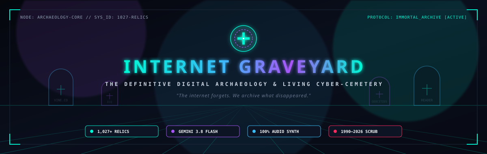
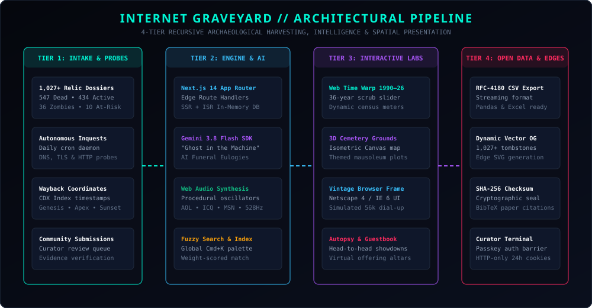

<div align="center">

<!-- Hero Banner -->


<br/><br/>

<!-- Animated Typing SVG -->
<a href="https://github.com/VarshuDev/internet-graveyard">
  
</a>

<br/>

<!-- High-Contrast Status Badges -->
<p align="center">
  <a href="https://github.com/VarshuDev/internet-graveyard/actions/workflows/ci.yml">
    
  </a>
  <a href="https://nextjs.org">
    
  </a>
  <a href="https://www.typescriptlang.org">
    
  </a>
  <a href="https://ai.google.dev">
    
  </a>
  <a href="https://developer.mozilla.org/en-US/docs/Web/API/Web_Audio_API">
    
  </a>
  <a href="https://tailwindcss.com">
    
  </a>
  <a href="LICENSE">
    
  </a>
</p>

<!-- Cyber Terminal Telemetry Box -->
```text
┌────────────────────────────────────────────────────────────────────────┐
│  > REPOSITORY     : VarshuDev // INTERNET-GRAVEYARD                    │
│  > CORPUS SIZE    : 1,027+ AUTHENTIC PRESERVED DIGITAL RELICS          │
│  > STATUS METRICS : 547 DEAD • 434 LIVING • 36 ZOMBIES • 10 AT-RISK    │
│  > INTELLIGENCE   : GOOGLE GEMINI 3.8 FLASH "GHOST IN THE MACHINE"     │
│  > ACOUSTIC SUITE : ZERO-MP3 PROCEDURAL WEB AUDIO SYNTHESIZER          │
│  > TIME HORIZON   : 1990 — 2026 CONTINUOUS WEB TIME WARP SCRUBBER     │
│  > PRIME MANDATE  : "THE INTERNET FORGETS. WE ARCHIVE WHAT DIED."      │
└────────────────────────────────────────────────────────────────────────┘
```

<p align="center">
  <a href="#flagship-laboratories--features"> Flagship Labs</a> &nbsp;&bull;&nbsp;
  <a href="#architectural-pipeline"> Architecture</a> &nbsp;&bull;&nbsp;
  <a href="#forensic-corpus--relic-breakdown"> Relic Corpus</a> &nbsp;&bull;&nbsp;
  <a href="#procedural-audio-vault"> Audio Vault</a> &nbsp;&bull;&nbsp;
  <a href="#quickstart--installation"> Quickstart</a> &nbsp;&bull;&nbsp;
  <a href="#open-data-hub"> Open Data</a> &nbsp;&bull;&nbsp;
  <a href="#security--curator-terminal"> Security</a>
</p>

</div>

<p align="center">
  
</p>

##  Overview &amp; Archival Mission

When tech conglomerates shutter platforms, servers go dark, domains expire, and decades of human digital culture evaporate into 404 errors. **Internet Graveyard** is an open-source, living cyber-cemetery and digital archaeological laboratory dedicated to excavating, verifying, and preserving the memory of fallen web services, abandoned protocols, and vanished internet communities.

Operating with forensic rigor, Internet Graveyard treats dead software with the solemnity of archaeological artifacts:

-  **1,027+ Authentic Preserved Relics**: 547 confirmed deceased, 434 platforms under living observation, 36 parked zombies, and 10 multi-signal at-risk candidates.
-  **AI "Ghost in the Machine" Machine Spirit Terminal**: Embedded on memorial dossiers, powered by Google's `@google/genai` (`gemini-3.8-flash`) with offline neural simulation fallback, enabling visitors to commune directly with the digital souls of historical platforms.
-  **AI Funeral Eulogy Generator &amp; Coroner Death Certificates**: Solemn commemorative funeral orations celebrating historical peaks, tragic fatal flaws, and eternal legacies, alongside printable autopsy certificates with cryptographic tamper-evident seals.
-  **Automated Health Prober &amp; Daily Inquest Cron**: Autonomous background daemon continuously testing authoritative DNS, TLS certificates, HTTP status codes, and domain squatter parking signatures.
-  **Zero-Dependency Procedural Web Audio Engine**: Dial-up handshakes, ICQ chirps, MSN nudges, Windows 95/98 startup pads, and 528Hz crystal singing bowl candles synthesized dynamically in real time via the Web Audio API without external MP3 files.
-  **Web Time Warp 1990—2026 Interactive Scrubber**: Scrub through 36 continuous years of internet history with dynamic census recalculations, milestone triggers, and demise radar.
-  **Open Archaeological Data Hub**: Streaming RFC-4180 CSV exports, complete JSON databases, SHA-256 integrity digests, and BibTeX academic citations.

<p align="center">
  
</p>

##  Flagship Laboratories &amp; Features

###  1. AI "Ghost in the Machine" Neural Terminal (`/grave/[slug]`)
- **Real-Time Spirit Communion**: Visitors engage in bi-directional dialogue with the lingering soul of any defunct platform (e.g., Vine, GeoCities, Club Penguin, Friendster, Google Reader).
- **Dual-Mode Intelligence**:
  - **Live Generative Stream**: Direct integration with `@google/genai` utilizing the ultra-low latency **`gemini-3.8-flash`** model.
  - **Offline Procedural Fallback**: Autonomous deterministic rule-based dialogue engine ensuring 100% uptime in offline or disconnected environments without API keys.
- **Retro Phosphor CRT UI**: Rendered with green/cyan CRT raster scanlines, audible typing clicks, and interactive prompt commands.

###  2. AI Funeral Eulogy Generator &amp; Coroner Death Certificate (`/grave/[slug]`)
- **Solemn Funeral Orations**: One-click modal summons the High Digital Mortician to orate a personalized funeral speech covering the platform's genesis, cultural heyday, tragic demise, and eternal legacy.
- **Coroner Autopsy Certificate**: Printable document with unique serial identifiers (`MORT-YYYY-SLUG-ID`), primary cause of death categorization, fatal forensic notes, and red wax stamp graphics.
- **Export Capabilities**: Instant PDF print preview, clipboard tribute copy, and cathedral death knell tolling.

###  3. Automated At-Risk Health Monitor &amp; Inquest Cron (`/dying-now` &amp; `/api/cron`)
- **Forensic Network Probing**: Probes candidates showing symptoms of infrastructure rot, TLS certificate expiration, domain parking redirects, or impending sunset announcements.
- **Automated Verification Matrix**: Multi-factor scoring across DNS resolution, HTTP status codes, WHOIS registrar changes, and Wayback capture delta.
- **Persistent Inquest Registry**: Audit logs written to `data/inquests.json` and queryable via `/api/inquests`.

###  4. Universal Global Command Palette (`Cmd+K` / `Ctrl+K`)
- **Instant Keyboard Navigation**: Accessible universally from any route with keyboard shortcut or navbar icon.
- **Multi-Field Fuzzy Query Matching**: Searches 1,027+ relics by name, slug, aliases, parent company, era, and cause of death.
- **Audible Haptic Feedback**: Procedural mechanical switch clicks on navigation and selection.

###  5. "Sounds of the Dead Web" Audio Relic Vault (`/sounds`)
- **100% Procedural Synthesis**: Synthesized purely with mathematical Web Audio API oscillators, noise buffers, and biquad filters:
  - **AOL 56k Dial-Up**: Complete DTMF dialing tones, carrier negotiation screech, and static hiss.
  - **ICQ "Uh-Oh!"**: Dual-tone incoming message chirp.
  - **MSN Messenger Nudge**: Dual-frequency bass punch with viewport earthquake tremor.
  - **Windows 95/98 Startup**: Brian Eno-inspired ethereal multi-oscillator chord pad.
  - **Club Penguin Dance Club**: 8-bit chiptune loop synthesis.
  - **AIM Instant Messenger**: Procedural wooden door latch acoustics.
  - **Skype Incoming Call**: Synthetic marimba bell arpeggios.

###  6. Head-to-Head Archaeological Autopsy Tool (`/compare`)
- **Comparative Post-Mortem Analysis**: Side-by-side autopsy breakdowns contrasting fallen pioneers against surviving successors:
  - **Vine vs. TikTok**: Creative micro-loops vs. algorithmic engagement optimization.
  - **MySpace vs. Facebook**: Unfettered HTML customizability vs. uniform identity directories.
  - **Napster vs. Spotify**: P2P piracy battles vs. licensed streaming models.
  - **Google Reader vs. Feedly**: Corporate deprecation vs. agile niche survival.
  - **Club Penguin vs. Roblox**: Curated Flash worlds vs. user-generated creator economies.

###  7. Interactive 3D Cemetery Grounds (`/grounds`)
- **Isometric Canvas Navigation**: Interactive HTML5 isometric Necropolis grid map.
- **Themed Plots &amp; Mausoleums**:
  - **The Google Mausoleum** (Reader, Plus, Wave, Stadia, Orkut, Songza, Buzz)
  - **The P2P &amp; Pirate Cove** (Napster, LimeWire, Kazaa, Grooveshark, Rdio)
  - **Web 1.0 &amp; Pioneer Row** (Netscape, AltaVista, Lycos, Ask Jeeves, GeoCities)
  - **Social Media Crypt** (Vine, MySpace, Friendster, Path, Secret, Yik Yak)
  - **Messaging Valley** (ICQ, AIM, MSN Messenger, Yahoo Messenger, Omegle)
  - **Gaming &amp; Virtual Row** (Club Penguin, Adobe Flash, PlayStation Home, Quibi)

###  8. "Web Time Warp" 1990—2026 Interactive Scrubber (`/time-warp`)
- **Continuous 36-Year Timeline Slider**: Tactile scrubber recalculating the internet census in real time:
  - **Surviving Platforms**: Total active platforms alive in any given year.
  - **Founding Milestones**: New entities launched in that historical epoch.
  - **Extinction Casualties**: Platforms terminated in that calendar year.
- **Playback Controls**: Play/pause autoplay, 1x/2x/4x speed acceleration, and quick-jump milestone buttons (1994 Early Web, 1999 Dot-Com Bubble, 2004 Web 2.0, 2012 Cloud/Mobile, 2024 Modern Sunset).

###  9. Virtual Offerings Altar &amp; Memorial Guestbook (`/grave/[slug]`)
- **Acoustic Offerings**:
  -  **Light 528Hz Memorial Candle**: Purifying crystal singing bowl chime.
  -  **Leave Digital Rose**: Reverberant Tibetan singing bowl.
  -  **Lay 3.5" Floppy Disk**: Tactile magnetic stepper motor acoustic click.
  -  **Toll Cathedral Death Knell**: Deep resonant funeral bell.
- **Permanent Epitaph Guestbook**: Public memory ledger allowing visitors to inscribe condolences, reflections, and nostalgic epitaphs directly onto tombstone memorials.

###  10. Vintage Browser Frame (Netscape 4 / IE 6) Time Capsule
- **Authentic Era UI**: Sandboxed archival viewer rendered inside vintage Netscape Navigator 4 and Internet Explorer 6 window frames.
- **Triple-Epoch Selector**: Genesis Launch &bull; Cultural Apex &bull; Final 404 Sunset.
- **Simulated 56k Modem Delay**: Optional simulated progress bar and acoustic connection sequence recreating authentic dial-up speeds.

###  11. Dynamic Vector OpenGraph Tombstone Engine (`/api/og`)
- **Edge Vector SVG Generation**: Dynamically generates unique high-resolution social preview cards for every one of the 1,027+ memorials.
- **Rich Metric Overlay**: Includes lifespan dates, category markers, cause of death summary, and live tribute candle counts for Twitter/X, Discord, and LinkedIn embeds.

###  12. Open Archaeological Data Hub (`/export`)
- **RFC-4180 Streaming CSV**: Optimized for data science workflows in Python (Pandas), R, and Tableau.
- **Full JSON Corpus**: Complete relational data dump with timelines, evidence arrays, and archived URLs.
- **Cryptographic Tamper-Proof Digest**: SHA-256 hash checksums ensuring archival provenance.
- **BibTeX Academic Citation**: One-click citation format for digital history researchers and scholars.

<p align="center">
  
</p>

##  Architectural Pipeline

```
  ┌──────────────────────┐       ┌────────────────────────┐       ┌──────────────────────┐       ┌──────────────────────┐
  │   TIER 1: INTAKE     │  ───► │   TIER 2: ENGINE & AI  │  ───► │  TIER 3: VISUAL LABS │  ───► │  TIER 4: OPEN DATA   │
  │                      │       │                        │       │                      │       │                      │
  │ • 1,027+ Relic Base  │       │ • Next.js 14 App Router│       │ • Web Time Warp 36yr │       │ • Streaming RFC CSV  │
  │ • Cron Daemon Prober │       │ • Gemini 3.8 Flash AI  │       │ • 3D Grounds Canvas  │       │ • Dynamic Vector OG  │
  │ • Wayback CDX Index  │       │ • Web Audio Synthesis  │       │ • Vintage Browser UI │       │ • SHA-256 Checksums  │
  │ • Community Intake   │       │ • In-Memory Index DB   │       │ • Autopsy Compare    │       │ • Curator Terminal   │
  └──────────────────────┘       └────────────────────────┘       └──────────────────────┘       └──────────────────────┘
```

<p align="center">
  
</p>

<p align="center">
  
</p>

##  Forensic Corpus &amp; Relic Breakdown

The catalog classifies every internet artifact under strict lifecycle states:

| Lifecycle State | Preserved Count | Description &amp; Verification Criteria |
| :--- | :---: | :--- |
|  **CONFIRMED_DEAD** | **547** | Permanently decommissioned, servers powered down, domain defunct or redirected, verified via primary corporate announcement and Wayback archival records. |
|  **ACTIVE** | **434** | Currently operating platforms tracked under living surveillance to document real-time shifts in ownership, traffic, and feature deprecation. |
|  **ZOMBIE** | **36** | Abandoned platforms or domains occupied by squatters, parked ad pages, or automated spam engines where original software is dead. |
|  **AT_RISK** | **10** | Platforms exhibiting critical infrastructure degradation, investor pullouts, expired SSL certificates, or official pre-sunset notifications. |
| **Total Archival Corpus** | **1,027+** | **Full archaeological coverage across Web 1.0, Web 2.0, Mobile Era, and Modern SaaS.** |

<p align="center">
  
</p>

##  Procedural Audio Vault

All acoustic relics in the vault are synthesized dynamically via the Web Audio API without relying on external media files:

```typescript
// Sample Procedural ICQ "Uh-Oh" Dual-Chirp Oscillator (lib/audio/soundArchive.ts)
const ctx = new (window.AudioContext || window.webkitAudioContext)();
const osc = ctx.createOscillator();
const gain = ctx.createGain();

osc.type = "sine";
osc.frequency.setValueAtTime(698.46, ctx.currentTime); // F5
osc.frequency.exponentialRampToValueAtTime(880.00, ctx.currentTime + 0.12); // A5

gain.gain.setValueAtTime(0.3, ctx.currentTime);
gain.gain.exponentialRampToValueAtTime(0.001, ctx.currentTime + 0.18);

osc.connect(gain);
gain.connect(ctx.destination);
osc.start();
osc.stop(ctx.currentTime + 0.18);
```

| Acoustic Relic | Synthesis Method | Acoustic Signature |
| :--- | :--- | :--- |
| **AOL 56k Dial-Up** | DTMF dual-tones + carrier frequency modulation + white-noise filter | Authentic 1990s modem handshake negotiation |
| **ICQ "Uh-Oh!"** | Dual sine oscillators with exponential frequency ramp | The universal instant messaging message alert |
| **MSN Nudge** | Low-frequency square wave sub-bass + viewport tremor sync | High-energy screen-shaking attention prompt |
| **Windows 95/98** | Polyphonic additive sine synthesis with Brian Eno envelope | Nostalgic multi-octave PC boot chord pad |
| **Club Penguin Club** | 8-bit periodic wave oscillator loop at 128 BPM | Chiptune dance floor synthesizer pattern |
| **AIM Door Latch** | Bandpass filtered noise burst + transient mechanical click | Classic buddy sign-on wooden door latch |
| **528Hz Memorial Candle**| Pure 528Hz Solfeggio sine wave with exponential decay | Meditative crystal singing bowl frequency |

<p align="center">
  
</p>

##  Quickstart &amp; Installation

### Prerequisites
- **Node.js**: v18.17.0 or newer (v20+ LTS recommended)
- **npm**, **pnpm**, or **yarn**

### 1. Clone the Repository
```bash
git clone https://github.com/VarshuDev/internet-graveyard.git
cd internet-graveyard
```

### 2. Install Dependencies
```bash
npm install
```

### 3. Configure Environment Variables (Optional)
Create a `.env.local` file in the project root:
```env
# Optional: Enables live Google Gemini 3.8 Flash AI ghost communion and eulogies
# If unset, the system automatically falls back to the deterministic procedural simulator
GEMINI_API_KEY=your_gemini_api_key_here

# Curator Command Center security passkey
ADMIN_SECRET_KEY=graveyard-curator-2024

# Scheduled Inquest Cron authorization secret
CRON_SECRET=your_cron_secret_here
```

### 4. Launch Local Development Server
```bash
npm run dev
```
Open **[http://localhost:3000](http://localhost:3000)** in your browser:
- **Central Monument Hub**: `http://localhost:3000/`
- **Archaeological Directory**: `http://localhost:3000/explore`
- **Web Time Warp Scrubber**: `http://localhost:3000/time-warp`
- **Sounds of the Dead Web**: `http://localhost:3000/sounds`
- **3D Cemetery Grounds**: `http://localhost:3000/grounds`
- **Autopsy Rivalries**: `http://localhost:3000/compare`
- **Vital Signs Network Scanner**: `http://localhost:3000/lookup`
- **Open Data Hub**: `http://localhost:3000/export`
- **Curator Terminal**: `http://localhost:3000/admin`

### 5. Build for Production
```bash
npm run build
npm run start
```

<p align="center">
  
</p>

##  Testing &amp; Verification

```bash
# Verify TypeScript compilation and schemas
npx tsc --noEmit

# Run production Next.js build
npm run build

# Execute standalone archaeological discovery crawler
npm run scrape
```

<p align="center">
  
</p>

##  Security &amp; Curator Terminal (`/admin`)

The platform contains an internal **Curator Command Terminal** designed for record curation, submission moderation, and scanner telemetry.

- **Public Route Obfuscation**: The `/admin` route is completely stripped from public navigation menus and sitemaps.
- **Passkey Challenge**: Access requires an authenticated passkey challenge setting a secure 24-hour HTTP-only session cookie.
- **API Guard**: All `/api/admin/*` routes enforce strict bearer token or cookie verification (`401 Unauthorized` on failure).
- **One-Click Session Termination**: Dedicated **"Lock Terminal"** control invalidates and purges the administrative cookie.

<p align="center">
  
</p>

##  Open Data Hub &amp; Academic Citation

Internet Graveyard provides unrestricted open access to its digital archaeology datasets:

- **JSON Corpus**: Direct export of all 1,027+ relic dossiers via [`/api/export/json`](https://internet-graveyard-seven.vercel.app/export)
- **RFC-4180 CSV**: High-speed streaming CSV export via [`/api/export/csv`](https://internet-graveyard-seven.vercel.app/api/export/csv)

### BibTeX Citation
```bibtex
@misc{varshudev2026internetgraveyard,
  author = {Varshan (VarshuDev)},
  title = {Internet Graveyard: Defunct Web Archaeology and Living Digital Cemetery},
  year = {2026},
  publisher = {GitHub},
  howpublished = {\url{https://github.com/VarshuDev/internet-graveyard}}
}
```

<p align="center">
  
</p>

##  Author &amp; Credits

Engineered and curated by **[VarshuDev](https://github.com/VarshuDev)**.

- **GitHub Profile**: [@VarshuDev](https://github.com/VarshuDev)
- **Repository**: [VarshuDev/internet-graveyard](https://github.com/VarshuDev/internet-graveyard)
- **Live Deployment**: [internet-graveyard-seven.vercel.app](https://internet-graveyard-seven.vercel.app/)

Historical archives and citations made possible by [The Internet Archive (Wayback Machine)](https://archive.org/) and the digital preservation community.

Released under the **[MIT License](LICENSE)**.

<div align="center">

```text
// END OF TRANSMISSION // INTERNET GRAVEYARD // MAY THEIR SERVERS REST IN PEACE //
```

</div>
